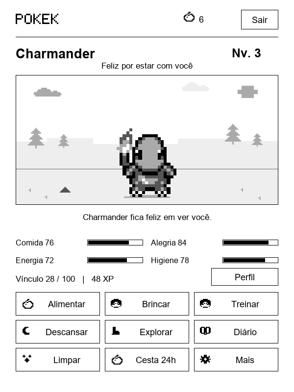

# PokeK — Pokémon para Kindle em PT-BR

Versão em português brasileiro baseada no projeto original [PokePal for Kindle](https://github.com/itsParassharma/Pokepal-for-Kindle), criado por **itsParassharma**. Base: 1.0.8.

Cuide de um companheiro Pokémon nas pausas de leitura: alimente, brinque, treine, explore trilhas e evolua. São 160 parceiros, ovos, metas semanais, decorações, diário e insígnias. Funciona offline.

Menus, diálogos, cuidados, golpes, tipos, conquistas e mensagens de erro do jogo estão em português brasileiro. Os nomes dos Pokémon e das frutas Oran, Pecha e Cheri foram preservados. As datas aparecem no formato dia/mês/ano.



*Prévia gerada pela interface do jogo no computador.*

## Arquivos para instalar

[Baixar a versão PT-BR](https://github.com/paulor8bit/Pokepal-for-Kindle-PTBR/releases/tag/v1.0.8-ptbr.1). Os pacotes também ficam em `dist/` após compilar:

- [PokeK-PTBR-v1.0.8-kual.zip](https://github.com/paulor8bit/Pokepal-for-Kindle-PTBR/releases/download/v1.0.8-ptbr.1/PokeK-PTBR-v1.0.8-kual.zip) — versão independente para KUAL.
- [PokeK-PTBR-v1.0.8-koreader.zip](https://github.com/paulor8bit/Pokepal-for-Kindle-PTBR/releases/download/v1.0.8-ptbr.1/PokeK-PTBR-v1.0.8-koreader.zip) — plugin para KOReader.
- [PokeK-PTBR-v1.0.8-corresponding-source.zip](https://github.com/paulor8bit/Pokepal-for-Kindle-PTBR/releases/download/v1.0.8-ptbr.1/PokeK-PTBR-v1.0.8-corresponding-source.zip) — código-fonte e dependências exatas da versão KUAL; mantenha junto ao executável ao redistribuir.
- [PokeK-PTBR-v1.0.8-SHA256.txt](https://github.com/paulor8bit/Pokepal-for-Kindle-PTBR/releases/download/v1.0.8-ptbr.1/PokeK-PTBR-v1.0.8-SHA256.txt) — hashes para verificar os downloads.

## Instalar pelo KUAL

Requer um Kindle com tela sensível ao toque, jailbreak e KUAL instalado. Não precisa de KOReader.

1. Extraia o ZIP do KUAL no computador.
2. Conecte o Kindle por USB e copie a pasta `extensions` para a raiz do Kindle, ao lado de `documents`. Mescle com a pasta existente.
3. Ejete o Kindle e abra **KUAL > PokeK PT-BR > Jogar PokeK**.

O executável é para Kindle ARMv7/Linux com tela sensível ao toque. A compatibilidade de toque, suspensão e atualização da tela precisa ser conferida no aparelho.

## Instalar pelo KOReader

1. Extraia o ZIP do KOReader no computador.
2. Copie a pasta `koreader` para a raiz do Kindle, mesclando com a instalação existente. O arquivo principal deve ficar em `koreader/plugins/pokepal.koplugin/main.lua`.
3. Reinicie o KOReader e procure **PokeK - Companheiro Pokémon** em **Ferramentas > Mais ferramentas**. O nome dos menus do KOReader depende do idioma dele.
4. Se não aparecer, confira se o plugin está ativado no gerenciamento de plugins.

## Saves e atualização

As duas versões compartilham `/mnt/us/pokepal/pokepal.dat`. Os diretórios técnicos `pokepal` e `pokepal.koplugin` foram mantidos para atualizar a instalação anterior e reutilizar os saves. Feche o jogo antes de abrir a outra versão.

Antes de atualizar, copie toda a pasta `pokepal` do Kindle para o computador. Atualize as duas versões se usar ambas. Saves antigos são copiados na primeira abertura, preservando os originais; se houver dois, o mais recente é escolhido.

Em **Mais > Backups**, salve um backup ou confira a prévia antes de restaurar. O jogo anterior fica em **Antes da restauração**. Se uma restauração for interrompida, feche e reabra o jogo.

## Leitura e cuidados

- Abra o jogo uma vez, leia e volte: cada 15 minutos registrados rende 1 fruta e 3 XP. O histórico anterior à ativação não gera recompensas.
- No Kindle, a leitura depende dos arquivos de tempo compatíveis ao lado do livro. No KOReader, mantenha o plugin ativado; o tempo dormindo ou dentro do jogo não conta.
- Em **Mais > Prêmios de leitura**, acompanhe ovos, metas de 60/120/180 minutos e histórico. Um ovo custa 3 frutas e choca após 120 minutos registrados.
- Em **Explorar**, escolha expedições por tempo ou pela leitura. O mesmo tempo pode avançar o ovo, a trilha e as recompensas.
- Em **Mais > Preferências**, ajuste o tamanho do texto, contraste e descanso automático. A tela de descanso com Pokémon e o rodapé estão disponíveis no KOReader. KUAL mantém a tela de descanso normal do Kindle.
- Em **Perfil**, troque de parceiro ou dê um apelido. Cada amigo mantém seu XP e vínculo; o apelido acompanha a evolução.

## Desenvolvimento

Com Python 3.12+, Git e Zig 0.13.0:

```sh
python -m pip install -r requirements-dev.txt
python tests/test_and_render.py
python tools/build_native.py --zig /caminho/para/zig --deps /caminho/para/cache
python tools/package_release.py --deps /caminho/para/cache
```

No Windows use o caminho de `zig.exe`. O build baixa revisões fixas de Lua, FBInk e stb. Para testar o renderizador nativo no computador, acrescente `--headless` ao build e execute o teste descrito em [native/README.md](native/README.md).

O catálogo revisado está em `tools/pt-BR.json`; `pokepal.koplugin/labels.lua` traduz rótulos cuja chave original precisa continuar no save. Os testes verificam regras, saves, leitura, interação e o espaço dos textos em várias telas. Eles não substituem o teste físico de toque e suspensão no Kindle.

## Créditos e licenças

Projeto original: **itsParassharma**. Tradução brasileira: **paulor8bit**. Sprites: [colaboradores do SpriteCollab](https://github.com/PMDCollab/SpriteCollab). Dados: [PokeAPI](https://github.com/PokeAPI/pokeapi).

Projeto de fãs, sem vínculo oficial. Pokémon pertence aos respectivos titulares. Código compartilhado: MIT. Host nativo e inicializadores: GPL-3.0-or-later. Os sprites têm termos próprios, incluindo atribuição e uso não comercial. As licenças e os registros originais de créditos foram preservados. Consulte [CREDITS.txt](pokepal.koplugin/CREDITS.txt).

Os documentos históricos em `docs/` e os avisos legais originais permanecem como referência da versão de origem.
